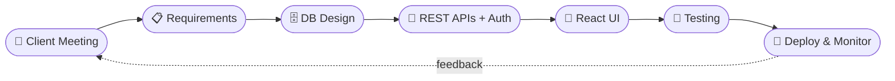

<!-- ============================ HERO ============================ -->
<div align="center">


<a href="https://github.com/NikhilNishad06">
  
</a>

<br/>


<br/><br/>

<a href="https://www.linkedin.com/in/nikhil-nishad-293176349"></a>
<a href="mailto:nikhilnishad622@gmail.com"></a>
<a href="https://github.com/NikhilNishad06"></a>


</div>


<!-- ============================ ABOUT ============================ -->

## 👨‍💻 &nbsp;About Me

<table>
<tr>
<td width="55%" valign="top">

```js
const nikhil = {
  role: "Full Stack Developer",
  company: "Botivate Services LLP",
  location: "Durg, Chhattisgarh 🇮🇳",
  education: "BCA · Kalinga University",
  cgpa: "3.79 / 4.00",
  experience: "1 year · production MERN apps",
  strengths: [
    "Requirement gathering on-site",
    "Scalable REST API design",
    "Secure auth (JWT + RBAC)",
    "Performance optimization",
  ],
  learning: ["DevOps", "Docker", "System Design"],
  motto: "Code • Build • Scale 🚀",
};
```

</td>
<td width="45%" valign="top">

🏢 Delivered **7 enterprise systems** — ERP, HR, MIS, Purchase & Sales, Document & Subscription management

🤝 Meet clients **on-site**, understand business workflows & turn them into secure software

⚡ Obsessed with **speed** — faster page loads, quicker APIs, tuned DB queries

🔐 Strong in **JWT, OAuth & Role-Based Access Control**

📊 Build **real-time dashboards**, reports & automated notification workflows

</td>
</tr>
</table>

<div align="center">

</div>


<!-- ============================ WORKFLOW ============================ -->

## ⚙️ &nbsp;How I Ship Software




<!-- ============================ TECH STACK ============================ -->

## 🛠 &nbsp;Tech Arsenal

<div align="center">

<table>
<tr>
<td align="center"><b>🔤 Languages</b></td>
<td></td>
</tr>
<tr>
<td align="center"><b>🎨 Frontend</b></td>
<td></td>
</tr>
<tr>
<td align="center"><b>⚙️ Backend</b></td>
<td></td>
</tr>
<tr>
<td align="center"><b>🗄️ Database</b></td>
<td></td>
</tr>
<tr>
<td align="center"><b>🧰 Tools & Cloud</b></td>
<td></td>
</tr>
</table>

<br/>


</div>


<!-- ============================ EXPERIENCE ============================ -->

## 💼 &nbsp;Experience Timeline

```text
 2026 ─────────────────────────────────────────────────────────▶ Present
   │
   ├── Jan 2026 – Feb 2026 ── 🎯 Full Stack Developer Intern   @ Botivate Services LLP
   │
   └── Mar 2026 – Present ─── 🚀 Full Stack Web Developer     @ Botivate Services LLP
```

<details open>
<summary><b>🚀 Full Stack Web Developer — Botivate Services LLP</b> &nbsp;<code>Mar 2026 – Present</code> &nbsp;<code>On-site, India</code></summary>
<br/>

- ✅ Delivered **7 enterprise web apps** end-to-end — UI, REST APIs, database design, testing & deployment
- ✅ Ran **on-site requirement-gathering** meetings and converted business workflows into production-ready software
- ✅ Built an **HR system with live location tracking** and outside-attendance monitoring for field staff (JWT + role-based dashboards)
- ✅ Implemented **RBAC, file uploads, reporting dashboards** and automated notification workflows
- ✅ **Optimized performance** — lower page load times, faster APIs, tuned database queries
- ✅ Collaborated with teams to ship features and resolve production issues with clean-code practices

**Stack:** `MongoDB` `Express.js` `React.js` `Node.js` `Supabase` `Tailwind CSS`

</details>

<details>
<summary><b>🎯 Full Stack Web Developer Intern — Botivate Services LLP</b> &nbsp;<code>Jan 2026 – Feb 2026</code></summary>
<br/>

- ✅ Assisted in building and maintaining client web applications across the complete MERN lifecycle
- ✅ Developed enterprise modules for ERP and HR management systems using REST API & database design best practices

**Stack:** `MongoDB` `Express.js` `React.js` `Node.js`

</details>


<!-- ============================ SYSTEMS BUILT ============================ -->

## 🏆 &nbsp;What I Build

<div align="center">

| 🏭 ERP Systems | 👥 HR Management | 📊 MIS Dashboards | 🛒 Purchase & Sales |
|:---:|:---:|:---:|:---:|
| Master data, roles & cross-department workflows | Attendance, live location & employee management | Real-time reports with Google Sheets automation | Order-to-delivery tracking & inventory |

| ✅ Task Delegation | 📄 Document Management | 🔔 Notifications | 🔐 Secure Access |
|:---:|:---:|:---:|:---:|
| Assignment, deadlines & status tracking | Document & subscription handling | Email / SMS automated workflows | JWT auth & role-based dashboards |

</div>


<!-- ============================ STATS ============================ -->

## 📈 &nbsp;GitHub Analytics

<div align="center">


<br/>


<br/>


<br/>


</div>


<!-- ============================ EDUCATION ============================ -->

## 🎓 &nbsp;Education

<table>
<tr>
<td width="50%" align="center">

### 🎓 BCA
**Kalinga University, Raipur**<br/>
Aug 2023 – Feb 2026<br/>


</td>
<td width="50%" align="center">

### 💻 Full Stack Web Development
**Avish Educom, Durg**<br/>
Feb 2026<br/>


</td>
</tr>
</table>


<!-- ============================ CONTACT ============================ -->

## 🤝 &nbsp;Let's Work Together

<div align="center">

```bash
$ whoami
> Nikhil Nishad — Full Stack Developer

$ status
> 🟢 Available for full-stack roles, freelance & collaborations
```

<a href="mailto:nikhilnishad622@gmail.com"></a>
<a href="tel:+916264345297"></a>
<a href="https://www.linkedin.com/in/nikhil-nishad-293176349"></a>

<br/><br/>


</div>
